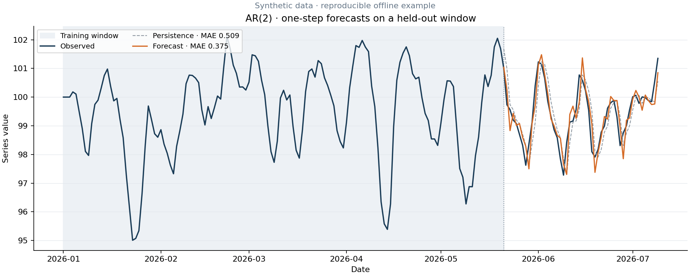
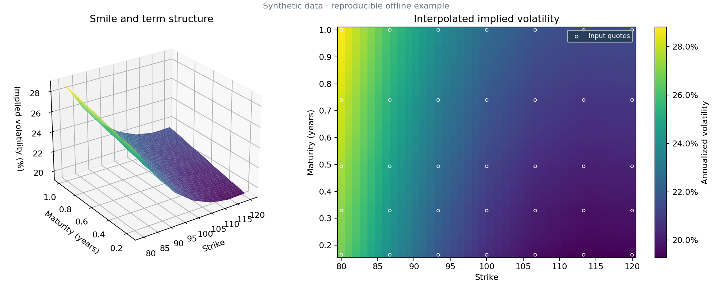

# Lazy financial market

Time-series forecasting, option valuation, strategy backtesting and paper trading.
Configurations inherit from Pydantic `BaseModel`; invalid parameters and unknown
configuration fields are rejected. Python 3.12+ is required.

This is a research/paper-trading toolkit. Live trading still needs verified market
data, a broker adapter, durable order state and product-specific margin/lifecycle handling.

| Package              | Tools                                                                                           |
|----------------------|-------------------------------------------------------------------------------------------------|
| `timeseries.models`  | Neural forecasting, ARIMA, GARCH, filtering, indicators, Black–Scholes, CRR trees               |
| `timeseries.metrics` | Sharpe, Sortino, Omega, drawdown, Calmar, volatility, returns, dependence                       |
| `timeseries.trading` | Strategies, walk-forward validation, backtests, portfolio accounting, risk limits, paper broker |
| `timeseries.options` | Implied-volatility surfaces, portfolio greeks, full-repricing scenarios                         |
| `services`           | FastAPI market-data, fundamentals and portfolio-valuation endpoints                             |

## Models and configurations

```python
from timeseries.models import ModelFactory, ConfigBlackScholes

config = ConfigBlackScholes(
    risk_free_rate = 0.03,
    volatility = 0.25,
    dividend_yield = 0.01
)
model = ModelFactory.create(
    config = config
)
premium = model.price(
    spot = 100,
    strike = 100,
    time_to_maturity = 1
)
greeks = model.greeks(
    100,
    100,
    1
)
iv = model.implied_volatility(
    premium,
    100,
    100,
    1
)  # 0.25

american = ModelFactory.create(
    "binomial",
    risk_free_rate = 0.03,
    volatility = 0.25,
    steps = 500
)
put = american.price(
    100,
    110,
    1,
    "put"
)
```

Black–Scholes supports European calls/puts, continuous dividends and NumPy
broadcasting. CRR trees support European/American exercise and continuous dividends;
set `american=False` for European options. Zero volatility and expiry are handled.
Discrete dividend schedules require a different model. Greeks require positive
maturity and volatility: theta is per year, vega per **1.0** volatility change,
rho per **1.0** rate change. Divide vega/rho by 100 for one percentage point.
IV inversion rejects prices outside European no-arbitrage bounds.

`ModelFactory.get_list_classes(domain="forecasting")` filters the catalog. Domains
also include `volatility`, `filtering`, `technical_analysis` and `option_pricing`.
`get_config(id, **params)` creates a config; `get_info(id)` returns metadata.
`create(id, config=config, **overrides)` validates overrides without changing the config.
Models declare `CONFIG_T` and register with `@ModelFactory.register(...)`; modules
under `timeseries/models` are discovered automatically. `ModelRegister` is an alias.

## Backtest a strategy

```python
import pandas as pd
from timeseries.trading import BacktestConfig, ExecutionConfig, MovingAverageStrategy, RiskLimits, backtest

bars = pd.DataFrame(
    {
        "open": [100, 101, 102, 103, 102, 104, 105, 104],
        "close": [101, 102, 103, 102, 104, 105, 104, 106],
        "volume": [100_000] * 8,
    },
    index = pd.date_range(
        "2026-01-01",
        periods = 8,
        tz = "UTC"
    )
)

config = BacktestConfig(
    initial_cash = 10_000,
    allocation = 0.45,
    spread_bps = 5,
    execution = ExecutionConfig(
        commission_per_unit = 0.01,
        slippage_bps = 2
    ),
    limits = RiskLimits(
        max_position_fraction = 0.5,
        max_gross_leverage = 1,
        max_drawdown = 0.2
    ),
)
result = backtest(
    bars,
    strategy = MovingAverageStrategy(
        fast = 2,
        slow = 3
    ),
    config = config
)
print(
    result.summary()
)
print(
    result.history[["equity", "cash", "quantity"]]
)
```

Signals are target weights in `[-1, 1]`, generated at the close and executed at the **next open**. Warm-up exposure is
zero. Custom signals can be passed as an aligned
Series: `backtest(bars, signals=my_signals, config=config)`. Short signals require
`RiskLimits(allow_short=True)`; the default is long/cash. Allocation scales targets.

The simulator rebalances each opening, applies spread/slippage/commissions, and
expires unfilled quantities after that opening quote. With `volume`, capacity is
`participation * previous_bar_volume`, rounded down: a liquidity proxy known before
execution. Without volume, capacity is unlimited. The final position stays open,
marked at the last close. Prices must be tradable prices; supply corporate-action
handling separately. Historical Yahoo prices alone do not provide delisted-universe
coverage, option quote history or point-in-time fundamentals.

Configure `annual_financing_rate` and `annual_short_borrow_rate` for ACT/365 borrowing
charges. There is no interest on positive cash. Drawdown/concentration/leverage
limits block risk increases while allowing reductions; they do not force liquidation.
Short availability and broker-specific margin schedules are outside this simulator.

## Walk-forward predictions



Offline AR(2) example: fit on 140 observations, evaluate the next 50. Each forecast
uses only observations before its target timestamp; coefficients stay fixed.
MAE is measured on the holdout and compared with the previous-value baseline.
The synthetic data are generated by an AR(2) process: this illustrates the API,
not performance on financial markets.

This example continues with `bars` and `config` above. Each fold fits a fresh model;
its prediction function only receives history through the current close.

```python
from timeseries.models import ModelFactory
from timeseries.trading import WalkForwardConfig, walk_forward_signals


def fit(
    train
):
    predictor = ModelFactory.create(
        "arima",
        p = 2,
        d = 1,
        q = 0
    )
    predictor.fit(
        train.to_numpy()
    )
    return lambda
        history: float(
        predictor.predict(
            history.to_numpy()
        )[0] > history.iloc[-1]
    )


signals = walk_forward_signals(
    bars.close,
    fit,
    WalkForwardConfig(
        train_size = 4,
        test_size = 2,
        gap = 1
    )
)
validated = backtest(
    bars,
    signals,
    config = config
)
```

Use `gap` to exclude recent training rows when forward labels overlap the test
period. Fit scalers and tune parameters inside `fit(train)`; keep a final evaluation
period separate. The callback is responsible for causal features and training labels.
The current ARIMA implementation fits AR coefficients; `q` is reserved.

## Paper execution and portfolio accounting

```python
from datetime import datetime, timedelta, timezone
from timeseries.instruments import Instrument, Quote
from timeseries.trading import ExecutionConfig, Order, PaperBroker, Portfolio, RiskLimits

now = datetime(
    2026,
    1,
    1,
    tzinfo = timezone.utc
)
stock = Instrument(
    symbol = "TEST"
)
broker = PaperBroker(
    [stock],
    portfolio = Portfolio(
        cash = 10_000
    ),
    execution = ExecutionConfig(
        commission_per_unit = 0.01
    ),
    limits = RiskLimits(
        max_position_fraction = 0.5
    )
)
order = Order(
    id = "entry-1",
    symbol = "TEST",
    quantity = 10,
    timestamp = now,
    limit_price = 101
)
broker.submit(
    order
)
broker.on_quote(
    Quote(
        symbol = "TEST",
        timestamp = now,
        bid = 100,
        ask = 101,
        ask_size = 4
    ),
    now
)
# Partial fill: four shares. A fresh quote can fill the remainder.
later = now + timedelta(
    seconds = 1
)
broker.on_quote(
    Quote(
        symbol = "TEST",
        timestamp = later,
        bid = 100,
        ask = 101,
        ask_size = 6
    ),
    later
)

print(
    broker.portfolio.equity(
        {"TEST": 102}
    )
)
print(
    broker.portfolio.realized_pnl,
    broker.portfolio.unrealized_pnl(
        {"TEST": 102}
    )
)
broker.reconcile(
    {"TEST": 10},
    expected_cash = 8989.9
)
snapshot = broker.portfolio.model_dump_json()
restored = Portfolio.model_validate_json(
    snapshot
)
broker.halt()  # Cancel pending orders and reject new ones.
```

Quantities are signed: positive buys, negative sells. Quotes use timezone-aware
exchange instants; stale/future/replayed quotes are rejected. Liquidity is shared
between orders on the same quote. Duplicate order IDs are idempotent; reusing an
ID with different parameters raises. Commission minimums apply **per fill**.
Equity peaks are updated only with fresh marks; expired option positions must be
settled before further executions.
Use `cancel(order_id)` to cancel a remainder. Positions use average cost and contract
multipliers; realized P&L includes commissions and accrued financing.

One account supports one currency. `Broker` defines the adapter protocol; this
implementation sends no live orders. Persist portfolio snapshots and reconcile after
restarting; pending orders/quote history are in memory and must be reconstructed by
a live adapter. Simulation fills do not establish live execution quality.

## Tail risk and option scenarios

```python
from timeseries.trading import TailRisk, stress_test

print(
    TailRisk(
        confidence = 0.95
    ).compute(
        [0.01, -0.03, 0.02, -0.08],
        capital = 10_000
    )
)
print(
    stress_test(
        restored,
        {"TEST": 102},
        {"crash": {"TEST": -0.2}}
    )
)
```

VaR and expected shortfall use historical one-period simple returns; expected
shortfall averages the worst probability mass, including a fractional boundary
observation. `stress_test` shocks instrument prices directly. For options, use full
repricing to shock the underlying, volatility and time instead:

```python
from timeseries.instruments import OptionContract
from timeseries.options import GreekLimits, OptionMarket, OptionScenario, portfolio_greeks
from timeseries.trading import Fill, Portfolio

contract = OptionContract(
    symbol = "CALL",
    underlying = "TEST",
    strike = 100,
    expiry = now + timedelta(
        days = 365
    ),
    option_type = "call"
)
options = Portfolio(
    cash = 10_000
)
options.apply(
    Fill(
        order_id = "option-1",
        symbol = "CALL",
        quantity = 1,
        price = 10,
        timestamp = now
    ),
    contract
)
markets = {
    "TEST": OptionMarket(
        as_of = now,
        spot = 100,
        volatility = 0.25
    )
}
exposures = portfolio_greeks(
    options,
    markets
)
greek_limits = GreekLimits(
    max_abs_delta = 100,
    max_abs_vega = 10_000
)
greek_limits.check(
    exposures
)
pnl = OptionScenario(
    spot_shocks = {"TEST": -0.1},
    volatility_shifts = {"TEST": 0.05},
    days = 1
).pnl(
    options,
    markets
)
print(
    exposures,
    pnl
)
```

Exposures include stock delta and contract multipliers, grouped by underlying.
Scenario P&L compares model values, with fixed rates/dividend yields. For pre-trade
Greek limits, pass `pre_trade_check=lambda p: greek_limits.check(portfolio_greeks(p, markets))`
to `PaperBroker`, keeping `markets` current. Analytical greeks/scenarios require
European exercise. Paper options support whole, long European cash-settled contracts;
`settle_option(symbol, underlying_quote, now)` requires the underlying settlement
price encoded as equal bid/ask at the exact expiry instant. American/physical assignment and uncovered short
options require a broker adapter and appropriate margin/lifecycle handling.

## Volatility surface and calibrated GARCH



The figure inverts 35 synthetic European call quotes across seven strikes and five
expiries, then interpolates total variance. White circles mark input quotes; colors
show annualized implied volatility. This is a diagnostic surface, with no guarantee
of static-arbitrage consistency. The minimal example below checks IV at a single node.

```python
from timeseries.options import OptionMarketQuote, VolatilitySurface

market = markets["TEST"]
price = market.model().price(
    100,
    100,
    1
)
quotes = [
    OptionMarketQuote(
        contract = contract,
        observed_at = now,
        bid = price - 0.01,
        ask = price + 0.01
    )
]
surface = VolatilitySurface.from_quotes(
    quotes,
    market
)
print(
    surface.volatility(
        strike = 100,
        maturity = 1
    )
)  # 0.25

returns = bars.close.pct_change().dropna()
# A longer sample is needed for calibration (at least 20 nonconstant returns).
import numpy as np

sample = np.random.default_rng(
    42
).normal(
    0,
    0.01,
    300
)
garch = ModelFactory.create(
    "garch"
).fit(
    sample
)
print(
    garch.fit_predict(
        sample,
        steps = 5
    )
)  # Per-observation volatility.
```

Supply multiple strikes/maturities for a surface. It inverts European midpoint
quotes, rejects wide/stale observations, and interpolates total variance without
extrapolation. Use one quote per strike/maturity. It is a diagnostic interpolation,
not an arbitrage-free calibration. Yahoo observation time is retrieval time, so it
cannot establish exchange freshness. GARCH uses stationary Gaussian maximum
likelihood; call `fit` explicitly, then `fit_predict` to filter/forecast. Annualize
per-observation volatility with `sqrt(periods_per_year)`. RegimeDetector uses causal
expanding volatility quantiles; warm-up labels are `-1`.

Regenerate both figures without downloading data:

```bash
.venv/bin/python -m examples.generate_readme_figures
```

The script uses `FigureConfig` (Pydantic) and a fixed seed; `--output-dir` and
`--seed` are optional. Reuse `timeseries.plotting.plot_volatility_surface(surface)`
or `plot_forecast(observed, predicted)` with your own data; both return a Matplotlib figure.

The next substantive improvements are historical bid/ask datasets and corporate
actions, arbitrage-constrained volatility calibration, execution models validated
against fills, and portfolio-level walk-forward benchmarks on unseen real data.

## Services

Run `python -m services.app --path_data ./data --path_report ./report --step_size 1`.

| Endpoint                                                    | Behavior                                                                 |
|-------------------------------------------------------------|--------------------------------------------------------------------------|
| `GET /load/ticker_ts?ticker=TEST`                           | Cached, unadjusted OHLCV prices                                          |
| `GET /indicators/?ticker=TEST`                              | Provider fundamentals; unavailable fields are null; ratios are decimals  |
| `GET /load/options?ticker=TEST&expiry=2027-01-15T21:00:00Z` | Filtered Yahoo option snapshots; exact expiry instant supplied by caller |
| `POST /load/portfolio/evaluate`                             | Value a `PortfolioSnapshot` supplied as JSON                             |
| `GET /load/portfolio`                                       | Read legacy `analysis.json`, or evaluate `portfolio.json` snapshot       |

`load_option_chain(ticker, expiry, exercise="american", settlement="physical")` is
also callable from Python. Quotes include volume, open interest, observation time
and last trade time when available. Contract exercise/settlement must match the
actual product. This endpoint supplies research snapshots, not historical chains or
an execution feed. Legacy price caches are rebuilt with `auto_adjust=False`.

```python
from pathlib import Path
from services.models.portfolio import PortfolioSnapshot

valuation = PortfolioSnapshot(
    as_of = now,
    portfolio = restored,
    marks = {"TEST": 102}
)
print(
    valuation.evaluate()
)
# Save under the server's --path_report directory, or POST the same JSON to the endpoint.
Path(
    "/tmp/portfolio.json"
).write_text(
    valuation.model_dump_json()
)
```

## Forecasting, metrics and tests

Use `timeseries.data_management.TimeSeries` for preparation, or
`timeseries.workflows.TimeSeries` for preparation plus training/inference/save/load.
Datasets include custom pandas series, synthetic signals, public forecasting
benchmarks and Monash archives. Public benchmark files must already be downloaded.

`timeseries.training.train_model(model, train_loader, validation_loader, epochs=20,
checkpoint_dir="checkpoints", device="cpu")` trains forecasting models, GNN and
legacy TFT through shared adapters. Checkpoints contain weights, optimizer,
scheduler and epoch; `best.pt` follows validation loss. Load weights with
`torch.load(path, weights_only=True)` then `model.load_state_dict(checkpoint["state_dict"])`.
Temporal splits fit scalers on training data.

Metrics use `MetricFactory.create("sharpe", periods_per_year=252)`, then `update`,
`compute`, `reset`. Inputs are **one-dimensional decimal simple returns**, not
prices; risk-free/target returns are per observation. Standard deviation is sample
based; drawdown is a positive loss fraction including initial capital. Undefined
ratios are NaN; nonzero ratios with zero denominator are infinite. Metrics use
constructor parameters, not `CONFIG_T`. `MetricRegister` remains an alias.

```bash
.venv/bin/python -m pytest tests -q
```

Tests cover numerical references/finite-difference greeks, IV inversion, early
exercise, accounting, costs, partial fills, risk rejection, expiry settlement,
causal signals, calibration, mocked providers and existing forecasting workflows.
The mathematical references are Hull, *Options, Futures and Other Derivatives*,
9th ed., chapters 13, 15 and 19–23. Pricing and backtests do not establish a
profitable trading edge.
